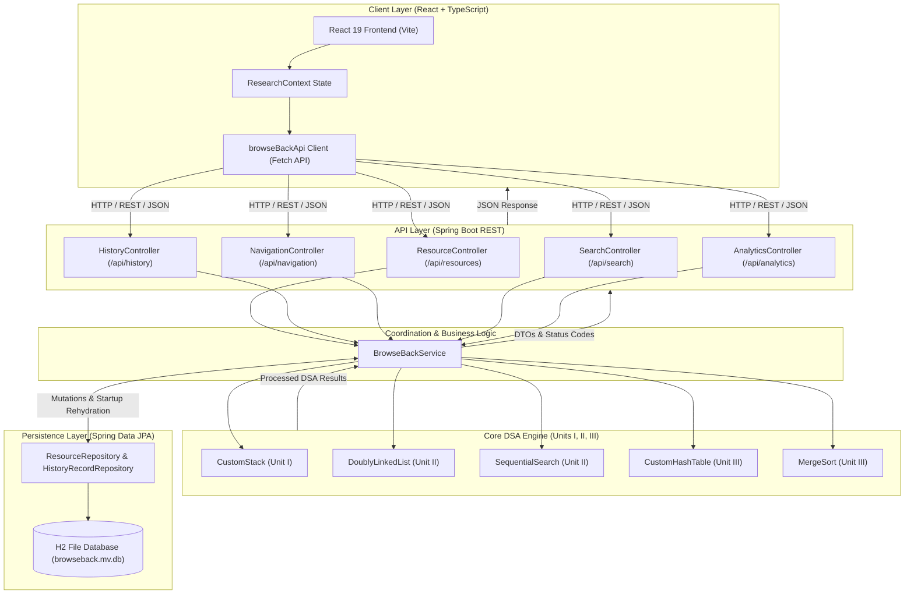
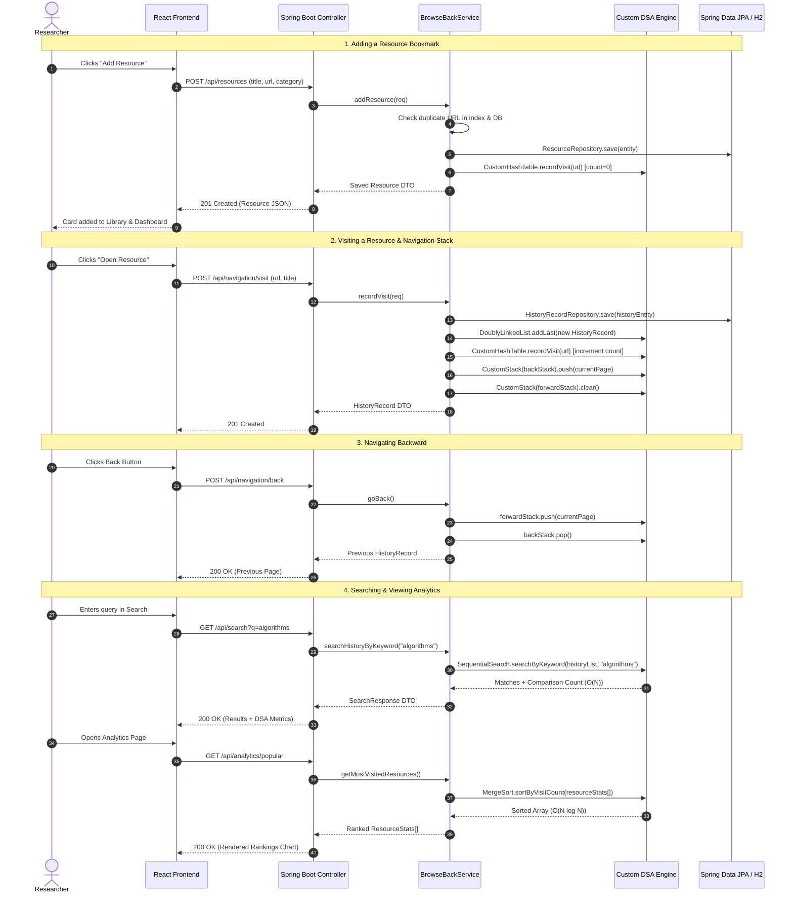

# BrowseBack — Smart Web Research Manager

An academic web research manager and browsing history tracker powered by a custom Data Structures and Algorithms (DSA) engine in Java, persistent storage with Spring Data JPA & H2, and a modern React + TypeScript dashboard. Built for college coursework covering **Units I, II, and III**.

---

## 1. Project Title and Overview

**BrowseBack — Smart Web Research Manager** bridges theoretical computer science data structures with real-world browser tab and research workflow management. While standard browsers treat bookmarks, open tabs, and navigation history as opaque black boxes, BrowseBack exposes and coordinates custom data structures—Stack, Doubly Linked List, Sequential Search, Hash Table with Separate Chaining, and Merge Sort—to organize research resources, track visit frequencies, and benchmark algorithmic performance.

All bookmarks and browsing history records persist safely across backend restarts using Spring Data JPA and a local file-based H2 database, while runtime operations execute directly on custom DSA data structures.

---

## 2. Real-World Problem Statement

Modern academic research and software engineering workflows involve navigating across dozens of lecture notes, documentation pages, repositories, and technical papers:
- **Lost Context & History Clutter**: Standard browser history accumulates thousands of unrelated web visits, making it tedious to reconstruct the exact sequence of research steps.
- **Bookmark Decay & Frequency Blindness**: Static browser bookmarks do not track how often a resource was actually referenced or when it was last consulted.
- **Educational Disconnect**: Students often study abstract data structures (stacks, linked lists, hash tables, sorting) in isolation on LeetCode without seeing how they coordinate in an interactive, full-stack application.

---

## 3. Proposed Solution

BrowseBack provides a dedicated research environment that:
1. **Emulates Browser History & Navigation**: Uses a custom **Doubly Linked List** for chronological timeline inspection and a dual **CustomStack** architecture for true LIFO Back/Forward traversal.
2. **Synchronizes Visit Frequencies**: Employs a custom **Hash Table with Separate Chaining** to map unique URLs to real-time visit counts in $O(1)$ average time.
3. **Ranks Critical Research Materials**: Uses a custom **Merge Sort** ($O(N \log N)$) to rank most-visited resources stably by access frequency.
4. **Empirically Demonstrates DSA Trade-offs**: Directly contrasts $O(N)$ Sequential Search against $O(1)$ Hash Table lookups using repeated measurements (5 iterations, 3 JIT warmup passes) on identical datasets.
5. **Persistent Storage with DSA Integrity**: Uses Spring Data JPA and file-based H2 storage to preserve data across server restarts, rehydrating custom DSA structures on application startup.

---

## 4. Main Features

- **Bidirectional Browsing History**: Traverse timeline forward (oldest to newest) and backward (newest to oldest) using custom linked nodes.
- **LIFO Navigation Stacks**: Dedicated Back and Forward navigation stacks where moving back/forward does not accidentally inflate visit counts.
- **Curated Research Library**: Saved bookmarks categorized by domain (Algorithms, Data Structures, System Design, etc.) with notes, tags, pinning, and duplicate URL prevention.
- **Persistent Local Database**: File-based H2 database (`./data/browseback.mv.db`) preserves all resources, visit counts, timestamps, and history records across application restarts.
- **Strict Data Consistency**: Deleting a history entry decrements visit count; an entry is only removed from the hash table when all history visits reach zero **and** no saved bookmark references it. Saved bookmarks survive clearing history.
- **Multi-Field Sequential Search**: Case-insensitive linear search across titles, URLs, and categories returning all matches with comparison step metrics.
- **Exact Hash Table URL Lookup**: Instant key-based lookup using custom polynomial rolling hash and separate chaining collision resolution.
- **Frequency Ranking via Merge Sort**: Stable, non-destructive descending sort ranking resources by access count.
- **Live Empirical Benchmarking**: Side-by-side empirical metrics evaluating both successful and unsuccessful lookups with repeated measurements and machine-dependent nanoTime reporting.

---

## 5. The Five Application Pages and Their Purposes

1. **Dashboard (`/`)**: High-level overview displaying aggregate research metrics (total bookmarks, visits, unique domains), quick-access pinned resources, recent browsing history cards, and quick navigation.
2. **Research Library (`/library`)**: The curated resource vault. Allows adding, editing, tagging, filtering by category, switching between grid and list views, detecting duplicate URLs, and launching external research URLs into the navigation stream.
3. **Browsing History (`/history`)**: Chronological visual timeline of all visited links. Displays stack pointer position, Back/Forward controls, and options to delete individual records or clear history with confirmation dialogs.
4. **Smart Search (`/search`)**: Interactive search terminal supporting both multi-field sequential search and exact hash-table URL lookup with collision-chain diagnostics and quick clear buttons.
5. **DSA Analytics (`/analytics`)**: Visual comparison suite showing Merge-Sort-ranked most-visited resources, frequency bar charts, aggregate KPI cards, and live comparative benchmarks of Sequential Scan ($O(N)$) vs Hash Table Lookup ($O(1)$).
6. **Settings & Storage (`/settings`)**: Backend endpoint configuration, live connection health check (`/api/health`), JSON backup export, and safe database reset controls.

---

## 6. DSA Concepts Mapped to Syllabus Units

| Unit | Data Structure / Algorithm | Class | Real-World Role in BrowseBack |
| :--- | :--- | :--- | :--- |
| **Unit I** | **Custom Stack (Linked Nodes, LIFO)** | `CustomStack<T>` | Dual Back and Forward browser navigation stacks |
| **Unit II** | **Doubly Linked List** | `DoublyLinkedList` | Chronological browsing timeline with `head` (oldest) and `tail` (newest) |
| **Unit II** | **Sequential Search** | `SequentialSearch` | Case-insensitive multi-match search across titles, URLs, and keywords |
| **Unit III** | **Custom Hash Table (Separate Chaining)** | `CustomHashTable` | URL frequency tracking, collision resolution, and $O(1)$ average exact lookup |
| **Unit III** | **Merge Sort (Divide-and-Conquer)** | `MergeSort` | Stable descending ranking of popular resources by visit count ($O(N \log N)$) |

---

## 7. Architecture and Workflow Diagrams

### Architecture Diagram



### System Workflows



---

## 8. Technology Stack

### Backend
- **Programming Language**: Java 17+ (Adoptium OpenJDK 25 compatibility)
- **Framework**: Spring Boot 3.2.5
- **Modules**:
  - `spring-boot-starter-web`: REST Controllers & MVC
  - `spring-boot-starter-data-jpa`: Relational entity persistence
  - `spring-boot-starter-validation`: Jakarta Bean Validation
  - `com.h2database:h2`: Local embedded file-based database
- **Build System**: Apache Maven 3.9.6
- **Testing**: JUnit 5 (Jupiter), Spring Boot Starter Test, MockMvc

### Frontend
- **Framework**: React 19 + TypeScript
- **Bundler & Tooling**: Vite 8.3
- **Styling**: Vanilla CSS with modern custom design system tokens, CSS Variables, glassmorphism, and responsive breakpoints
- **Icons**: Lucide React
- **Routing**: React Router DOM 7

---

## 9. Project Folder Structure

```
BrowseBack/
├── README.md                           # Root project documentation
├── package.json                        # Frontend NPM package config
├── tsconfig.json                       # TypeScript config
├── vite.config.ts                      # Vite configuration
├── index.html                          # Frontend entry HTML
├── src/                                # Frontend Source Code
│   ├── main.tsx                        # React DOM mounting
│   ├── App.tsx                         # Router and page composition
│   ├── index.css                       # Core design system tokens & utilities
│   ├── types/
│   │   └── index.ts                    # TypeScript domain interfaces
│   ├── services/
│   │   └── api.ts                      # Spring Boot REST API client
│   ├── context/
│   │   └── ResearchContext.tsx         # Global research & navigation state
│   ├── components/
│   │   ├── common/                     # Reusable UI components (Badge, Modal, ConfirmDialog)
│   │   ├── layout/                     # AppLayout, Header, Sidebar
│   │   ├── library/                    # ResourceCard, ResourceListItem, ResourceModal
│   │   └── history/                    # StackIndicator, HistoryTimelineItem
│   ├── pages/
│   │   ├── DashboardPage.tsx           # Dashboard view
│   │   ├── LibraryPage.tsx             # Curated bookmarks library
│   │   ├── HistoryPage.tsx             # Timeline & stack navigation
│   │   ├── SearchPage.tsx              # Sequential vs hash search
│   │   ├── AnalyticsPage.tsx           # MergeSort rankings & empirical benchmarks
│   │   └── SettingsPage.tsx            # API endpoint settings & database reset
│   └── data/
│       └── initialData.ts              # Initial sample dataset
├── browser-extension/                  # Chrome Manifest V3 History Sync Extension
│   ├── manifest.json                   # Extension manifest (MV3, history & storage permissions)
│   ├── background.js                   # Service worker with Chrome History API & batch sync
│   ├── content.js                      # Local web app communication bridge
│   ├── popup.html                      # Extension toolbar popup UI
│   ├── popup.js                        # Popup controller & sync trigger
│   ├── popup.css                       # Modern dark/light styling
│   └── icons/                          # Extension icons (16, 48, 128px)
└── backend/                            # Spring Boot Java DSA Backend
    ├── pom.xml                         # Maven build file with Spring Boot, JPA, H2
    ├── mvn.cmd                         # Maven execution wrapper script
    ├── README.md                       # Backend specific documentation
    ├── data/                           # Local H2 persistent database folder (*.mv.db, git-ignored)
    └── src/
        ├── main/
        │   ├── java/com/browseback/
        │   │   ├── BrowseBackApplication.java   # Spring Boot entry point
        │   │   ├── Main.java                    # Standalone interactive DSA driver
        │   │   ├── config/
        │   │   │   └── CorsConfig.java          # Frontend CORS configuration
        │   │   ├── controller/                  # REST API Controllers
        │   │   │   ├── ResourceController.java
        │   │   │   ├── HistoryController.java
        │   │   │   ├── NavigationController.java
        │   │   │   ├── SearchController.java
        │   │   │   ├── AnalyticsController.java
        │   │   │   └── HealthController.java
        │   │   ├── service/
        │   │   │   └── BrowseBackService.java   # Service coordinating DSA & persistence
        │   │   ├── entity/                      # JPA Database Entities
        │   │   │   ├── ResourceEntity.java
        │   │   │   └── HistoryRecordEntity.java
        │   │   ├── repository/                  # Spring Data JPA Repositories
        │   │   │   ├── ResourceRepository.java
        │   │   │   └── HistoryRecordRepository.java
        │   │   ├── dsa/                         # Core Custom Scratch DSA Implementations
        │   │   │   ├── CustomStack.java         # Unit I: Linked LIFO stack
        │   │   │   ├── DoublyLinkedList.java    # Unit II: Bidirectional history
        │   │   │   ├── SequentialSearch.java    # Unit II: Case-insensitive search
        │   │   │   ├── CustomHashTable.java     # Unit III: Separate chaining hash
        │   │   │   └── MergeSort.java           # Unit III: Stable divide-and-conquer
        │   │   ├── model/                       # Domain POJOs
        │   │   │   ├── HistoryRecord.java
        │   │   │   ├── HistoryNode.java
        │   │   │   ├── HashEntry.java
        │   │   │   ├── Resource.java
        │   │   │   └── ResourceStats.java
        │   │   ├── dto/                         # Data Transfer Objects
        │   │   │   ├── CreateResourceRequest.java
        │   │   │   ├── UpdateResourceRequest.java
        │   │   │   ├── VisitRequest.java
        │   │   │   ├── NavigationStateResponse.java
        │   │   │   ├── AnalyticsSummaryResponse.java
        │   │   │   ├── SearchResponse.java
        │   │   │   ├── ExactLookupResponse.java
        │   │   │   └── PerformanceComparisonResponse.java
        │   │   └── exception/
        │   │       └── GlobalExceptionHandler.java
        │   └── resources/
        │       └── application.properties       # File H2 URL & server configuration
        └── test/
            ├── resources/
            │   └── application.properties       # In-memory H2 URL for isolated testing
            └── java/com/browseback/
                ├── dsa/                         # DSA Unit Tests (44 tests)
                │   ├── CustomStackTest.java
                │   ├── DoublyLinkedListTest.java
                │   ├── SequentialSearchTest.java
                │   ├── CustomHashTableTest.java
                │   └── MergeSortTest.java
                ├── service/                     # Coordination & Benchmark Tests (11 tests)
                │   └── BrowseBackServiceTest.java
                └── controller/                  # Integration & Persistence Tests (16 tests)
                    └── BrowseBackIntegrationTest.java
```

---

## 10. Explanation of Each Custom DSA Class

### 1. `CustomStack<T>` (Unit I)
- **Concept**: Linked-node implementation of a LIFO stack. Elements are linked forward from `top` to `null`.
- **Why from Scratch**: Built without `java.util.Stack`, `java.util.Deque`, or `LinkedList`.
- **Role in Project**: Two independent instances are maintained in `BrowseBackService`: `backStack` and `forwardStack`. When visiting a new link, the active page is pushed to `backStack` and `forwardStack` is cleared. Moving Back/Forward does not trigger visit recording.

### 2. `DoublyLinkedList` (Unit II)
- **Concept**: Linked list where every `HistoryNode` holds references to both `prev` and `next` nodes, with permanent pointers to `head` (oldest record) and `tail` (newest record).
- **Why from Scratch**: Does not use `java.util.LinkedList`.
- **Role in Project**: Supports bidirectional browsing history traversal (`traverseForward()`, `traverseBackward()`), $O(1)$ appends at `tail`, and $O(1)$ unlinking once a target node ID is matched. Duplicate URLs are naturally supported. Rebuilt from database on application startup.

### 3. `SequentialSearch` (Unit II)
- **Concept**: Case-insensitive linear scanning algorithm evaluating each record against search parameters.
- **Role in Project**: Performs substring searching over titles, URLs, and categories. Returns all matches while simultaneously recording the number of string comparisons and elapsed CPU nanoseconds.

### 4. `CustomHashTable` (Unit III)
- **Concept**: Bucket array with separate chaining for collision resolution.
- **Hash Function**: Polynomial rolling hash:
  $$\text{hash} = \sum_{i=0}^{L-1} c_i \cdot 31^{L-1-i} \pmod{2^{31}-1}$$
  Mapped to bucket index via `(hash & 0x7fffffff) % capacity`.
- **Rehashing**: Dynamically rehashes to the next prime capacity when the load factor $\alpha = \frac{N}{\text{capacity}} \ge 0.75$.
- **Role in Project**: Maintains unique URL visit counts in $O(1)$ average time. Synchronized with `DoublyLinkedList` so deleting a history record decrements the URL's counter. Rebuilt on application startup from persisted records.

### 5. `MergeSort` (Unit III)
- **Concept**: Divide-and-conquer comparison sorting algorithm:
  - Divides array recursively into halves until subarrays have length $\le 1$.
  - Merges sorted halves in **descending** order of visit count using $\ge$ comparison.
- **Stability**: Elements with identical visit counts preserve their original relative order. Does not mutate the input array.
- **Role in Project**: Ranks most-visited resources for the dashboard and analytics pages.

---

## 11. REST API Endpoint Documentation

| Method | Endpoint | Request Body | Status | Description |
| :--- | :--- | :--- | :--- | :--- |
| **GET** | `/api/resources` | None | `200 OK` | Retrieves all saved research resources |
| **POST** | `/api/resources` | `CreateResourceRequest` JSON | `201 Created` | Creates a new research resource bookmark (rejects duplicates) |
| **GET** | `/api/resources/{id}` | None | `200` / `404` | Retrieves one resource by ID |
| **PUT** | `/api/resources/{id}` | `UpdateResourceRequest` JSON | `200` / `404` | Updates an existing resource |
| **DELETE** | `/api/resources/{id}` | None | `204 No Content` | Deletes a resource (preserves browsing history) |
| **POST** | `/api/resources/reset` | None | `200 OK` | Resets database and DSA indices to default sample data |
| **GET** | `/api/history` | None | `200 OK` | Retrieves browsing history in reverse order |
| **DELETE** | `/api/history/{id}` | None | `204 No Content` | Deletes one visit & decrements hash count |
| **DELETE** | `/api/history` | None | `204 No Content` | Clears browsing history (preserves bookmarks) |
| **POST** | `/api/navigation/visit` | `VisitRequest` JSON | `201 Created` | Opens or records a resource visit |
| **POST** | `/api/navigation/back` | None | `200` / `400` | Navigates back via CustomStack |
| **POST** | `/api/navigation/forward`| None | `200` / `400` | Navigates forward via CustomStack |
| **GET** | `/api/navigation/current`| None | `200 OK` | Retrieves active page & stack sizes |
| **GET** | `/api/search?q={query}` | Query Param `q` | `200 OK` | Sequential search with comparison metrics |
| **GET** | `/api/search/url?url={u}`| Query Param `url` | `200 OK` | Exact URL lookup via CustomHashTable |
| **GET** | `/api/analytics/summary`| None | `200 OK` | Resource, history, and domain totals |
| **GET** | `/api/analytics/popular`| None | `200 OK` | Most-visited ranking via MergeSort |
| **GET** | `/api/analytics/performance`| Query Param `url` (optional) | `200 OK` | Sequential vs Hash empirical comparison |
| **GET** | `/api/health` | None | `200 OK` | Backend health check |

---

## 12. Persistent Storage & Database Configuration

### Database Architecture
- **Runtime Persistence**: File-based H2 database stored at `backend/data/browseback.mv.db`.
- **JDBC URL**: `jdbc:h2:file:./data/browseback;DB_CLOSE_DELAY=-1;AUTO_SERVER=TRUE`
- **Rehydration Workflow**: On backend startup, `BrowseBackService` queries `ResourceRepository` and `HistoryRecordRepository`, rebuilding the in-memory `CustomHashTable` and `DoublyLinkedList`.
- **Navigation Stacks**: Navigation stacks (`backStack` and `forwardStack`) remain in-memory runtime session state.
- **Isolated Testing Database**: Automated tests use an isolated in-memory database (`jdbc:h2:mem:testdb`) specified in `src/test/resources/application.properties` to ensure zero side-effects on development data.

### How to Safely Reset Local Development Data
Choose either of the two supported approaches:
1. **Via UI or API (Recommended)**:
   - Navigate to the **Settings** page in the frontend and click **Reset to Sample Data**, or
   - Send an HTTP POST request to: `POST http://localhost:8080/api/resources/reset`.
2. **Via Filesystem**:
   - Stop the Spring Boot backend server.
   - Delete the directory `backend/data/` (or the files `browseback.mv.db` and `browseback.trace.db`).
   - Restart the backend server. The database and sample dataset will be cleanly recreated.

---

## 13. Setup Prerequisites

- **Java Development Kit (JDK)**: Version 17 or higher (tested with Eclipse Adoptium OpenJDK 25).
- **Node.js**: Version 18 or higher (with `npm`).
- **Operating System**: Windows, macOS, or Linux.

---

## 14. Installation and Run Instructions

### Step 1: Start the Java Spring Boot Backend

Open a terminal in the project root:

```powershell
# Navigate to backend directory
cd backend

# Compile and run the Spring Boot application
.\mvn.cmd spring-boot:run
```

The backend server starts on `http://localhost:8080`.  
Verify health by visiting: `http://localhost:8080/api/health`

### Step 2: Start the React Frontend

Open a second terminal in the project root:

```powershell
# Navigate to root directory
cd e:\BrowseBack

# Install dependencies (if not already installed)
npm install

# Start Vite development server
npm run dev
```

The frontend launches on `http://localhost:5173`. Open your browser to explore the dashboard.

---

## 15. Environment Variable Configuration

Create a `.env` file in the project root (optional; defaults are preset):

```env
# URL where Spring Boot backend is accessible
VITE_API_BASE_URL=http://localhost:8080/api
```

Backend CORS is configured in `backend/src/main/resources/application.properties`:

```properties
server.port=8080
browseback.cors.allowed-origins=http://localhost:5173,http://localhost:3000,http://127.0.0.1:5173,http://127.0.0.1:3000
```

---

## 16. How to Run Tests

### Running Backend Tests (63 Total Tests)

```powershell
cd backend

# Run all 63 JUnit 5 unit & Spring Boot integration tests
.\mvn.cmd test

# Run interactive terminal demo showcasing all DSA classes
.\mvn.cmd exec:java
```

### Building Frontend Production Bundle

```powershell
cd e:\BrowseBack

# Run TypeScript checks and Vite production build
npm run build
```

---

## 17. Time Complexities of Implemented Operations

| Module | Operation | Best Case | Average Case | Worst Case | Space Complexity |
| :--- | :--- | :---: | :---: | :---: | :---: |
| **CustomStack** | `push()`, `pop()`, `peek()` | $O(1)$ | $O(1)$ | $O(1)$ | $O(N)$ total |
| **DoublyLinkedList** | `addLast()` (tail append) | $O(1)$ | $O(1)$ | $O(1)$ | $O(1)$ aux |
| **DoublyLinkedList** | `traverseForward()`, `traverseBackward()` | $O(N)$ | $O(N)$ | $O(N)$ | $O(N)$ aux |
| **DoublyLinkedList** | `deleteById()` | $O(1)$ | $O(N)$ | $O(N)$ | $O(1)$ aux |
| **SequentialSearch** | `searchByKeyword()` (all matches) | $O(N)$ | $O(N)$ | $O(N)$ | $O(M)$ matches |
| **CustomHashTable** | `recordVisit()` (insert/update) | $O(1)$ | $O(1)$ | $O(N)^*$ | $O(N)$ total |
| **CustomHashTable** | `search()` / `contains()` | $O(1)$ | $O(1)$ | $O(N)^*$ | $O(1)$ aux |
| **CustomHashTable** | `rehash()` | $O(N)$ | $O(N)$ | $O(N)$ | $O(N)$ aux |
| **MergeSort** | `sortByVisitCount()` | $O(N \log N)$ | $O(N \log N)$ | $O(N \log N)$ | $O(N)$ buffer |

*\*Worst case occurs only if all keys hash to a single bucket collision chain, mitigated by polynomial rolling hash and prime table capacity.*

---

## 18. Actual Limitations & Future Enhancements

### Limitations
1. **Manual / In-App Visit Recording**: Visits are recorded via the in-app "Open Resource" triggers, search launches, or the REST API. Does not automatically inspect local Google Chrome / Mozilla Firefox binary SQLite history files due to OS sandboxing and security restrictions.
2. **Single-Node Execution**: Designed for local workstation use and academic demonstration.
3. **No Authentication**: Built for single-user local research session workflows; multi-user authorization and JWT tokens are not implemented.

### Future Enhancements
- **Browser Extension**: A lightweight Chrome/Firefox Manifest V3 extension to forward real-time visited tab URLs to `/api/navigation/visit`.
- **Advanced DSA Additions**:
  - **Trie (Prefix Tree)** for $O(L)$ URL prefix autocompletion.
  - **LRU Cache** using a combination of Custom Hash Table and Doubly Linked List for recently accessed resources.
  - **Min-Heap / Priority Queue** for top-$K$ resources retrieval in $O(N \log K)$.

---

## 19. Author and Microproject Details

- **Project**: BrowseBack — Smart Web Research Manager
- **Course**: Data Structures and Algorithms (College Microproject)
- **Covered Units**: Unit I (Stacks), Unit II (Linked Lists & Sequential Search), Unit III (Hashing & Sorting)
- **Department**: Department of Computer Science & Engineering
